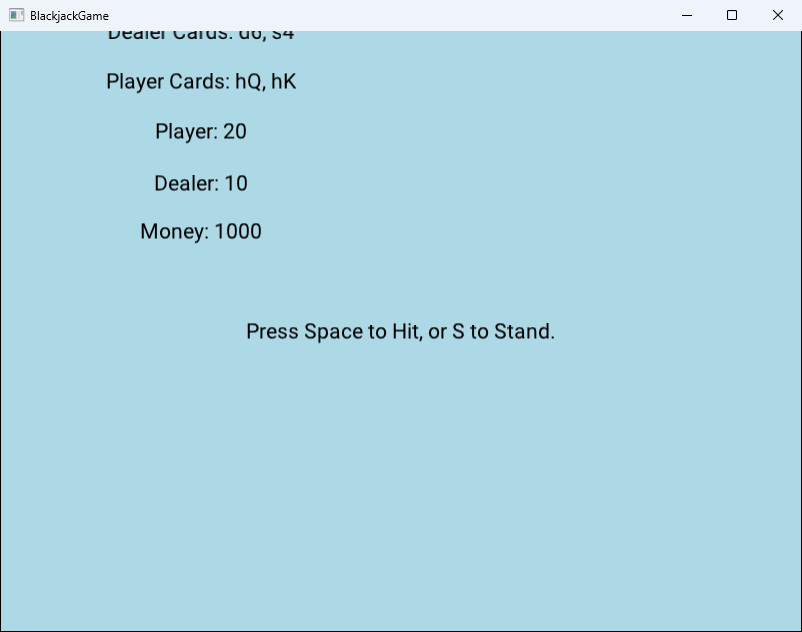

# Blackjack

Blackjack-korttipeli, jossa pelaaja pelaa jakajaa vastaan.

Tein pelin Jyväskylän yliopiston **Ohjelmointi 1** -kurssin harjoitustyönä syksyllä 2024. Se on toteutettu C#:lla ja JYU:n Jypeli-pelikirjastolla.



## Pelin kulku

- Pelaaja ja jakaja saavat kumpikin kaksi korttia.
- Pelaaja voi ottaa lisää kortteja tai jäädä nykyiseen käteensä. Jos summa ylittää 21, pelaaja häviää kierroksen.
- Kun pelaaja jää, jakaja ottaa kortteja, kunnes sillä on vähintään 17 pistettä.
- Kierroksen voittaa se, jonka summa on lähempänä 21:tä ylittämättä sitä. Tasapeli on mahdollinen.
- Kuvakortit ovat 10 pisteen arvoisia. Ässä on 11 pistettä, tai 1 piste, jos summa muuten ylittäisi 21.
- Pelaaja aloittaa 1000 rahalla, ja jokaisen kierroksen panos on 100. Uusi kierros alkaa automaattisesti kahden sekunnin kuluttua edellisen päättymisestä.

Kortit näytetään muodossa maa + arvo: `h` = hertta, `d` = ruutu, `c` = risti, `s` = pata. Esimerkiksi `hQ` on hertta-kuningatar ja `s4` pata-nelonen.

## Ohjaimet

| Näppäin | Toiminto |
|---|---|
| Välilyönti | Ota kortti (hit) |
| S | Jää (stand) |
| Enter | Jaa uudet kortit |
| Esc | Lopeta peli |

## Tekniikat

- C# ja .NET 8
- [Jypeli](https://github.com/Jypeli-JYU/Jypeli) 11, Jyväskylän yliopiston pelikirjasto
- Pakan sekoitukseen Fisher–Yates-algoritmi

## Käynnistys

Tarvitset [.NET 8 SDK:n](https://dotnet.microsoft.com/download/dotnet/8.0). Ensimmäisellä käynnistyskerralla `dotnet` lataa Jypeli-kirjaston NuGetistä, joten silloin tarvitaan internetyhteys.

**Windows:** tuplaklikkaa tiedostoa `kaynnista.bat`.

**Komentoriviltä:**

```
cd ht1
dotnet run
```

## Rakenne

```
ht1/
├── Ohjelma.cs              Ohjelman käynnistys (Main)
├── BlackjackGame.cs        Peli: säännöt, pisteiden lasku ja näkymä
└── BlackjackGame.csproj    Projektitiedosto ja riippuvuudet
suunnitelma/                Harjoitustyön suunnitelman kuvat
kuvat/                      Kuvakaappaukset
```

`BlackjackGame.cs` sisältää kolme luokkaa:

- `BlackjackGame` hoitaa pelin kulun, näppäinkomennot, pisteiden laskun ja tekstikenttien päivityksen.
- `Deck` on 52 kortin pakka, joka osaa sekoittaa itsensä ja jakaa kortin päältä.
- `Card` on yksittäinen kortti, jolla on arvo ja maa.

## Tunnetut rajoitukset

- Kortit näytetään tekstinä eikä kuvina.
- Panos on aina 100, eikä sitä voi muuttaa.
- Jakajan molemmat kortit näkyvät heti, vaikka oikeassa blackjackissa toinen on piilossa.
- Peli ei pääty, vaikka rahat loppuvat, vaan saldo voi mennä negatiiviseksi.
- Pakkaa ei täytetä kierrosten välillä, joten peli kaatuu noin kymmenen kierroksen jälkeen, kun kortit loppuvat.

## Tekijä

Tomas Vallas
